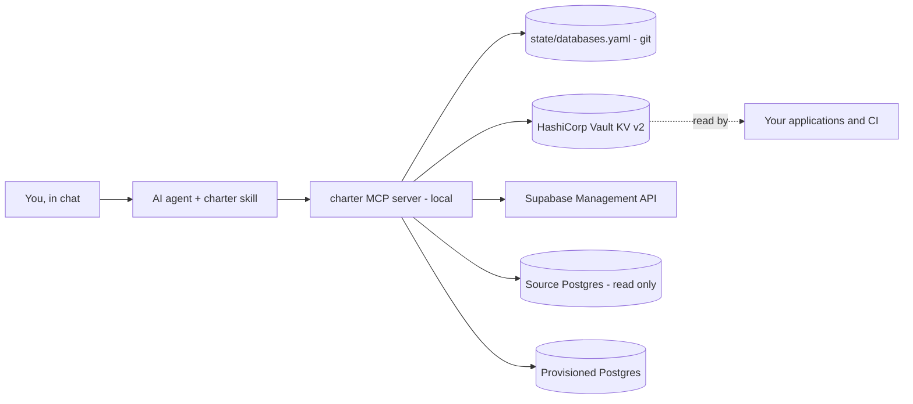

# Charter

**On-demand Supabase databases, accounted for.**

An MCP server that lets you ask an AI agent, in plain English, to create a
Supabase database of any kind, keep its credentials in HashiCorp Vault, copy
data into it from an existing database, rotate its password, and delete it when
it is no longer needed.

It works for the whole range of databases, not just throwaway ones:

- a **production** database for a new service, long-lived, its credentials
  written to the production Vault mount;
- a **staging** backend that mirrors production structure;
- a **dev** database for a feature branch;
- a **demo** database for a customer proposal, seeded with a slice of real data;
- a throwaway **poc** or **test** database for an experiment or a load test.

```
"Create a production database for the billing service, secret path billing."

"I need a demo database for the Acme proposal, secret path acme, small size,
 for 5 days."

"Copy customers and orders from January to March 2026 into it."

"The Acme demo is over, delete the database."
```

Each sentence can be a separate chat, days or weeks apart, or several can be one
message. The agent keeps its own ledger, so it always knows which databases it
created and refuses to touch anything else.

Design rationale: [docs/design.md](docs/design.md).
Step-by-step setup and daily use: [docs/guide.md](docs/guide.md).

---

## 1. Why this exists

Creating a database by hand is a chain of small steps that are easy to get
wrong and easy to forget: create the project, pick a compute size, wait for it
to come up, collect the keys, put them somewhere safe, remember that it exists,
and delete it when it is done. The tedious parts get skipped, so credentials end
up in a chat message and databases stay billed for months.

This agent makes the whole chain one sentence, and makes the parts that matter
non-optional:

- **credentials only ever go to Vault**, never to chat, a file, or a tool result;
- **every database is recorded** in a git-reviewed ledger, so there is always an
  answer to "what exists and who asked for it";
- **nothing outside that ledger can be touched**, so the blast radius of a
  misunderstood instruction is bounded by construction.

The official Supabase MCP server can create a project, but it cannot choose the
compute size and it cannot delete one. The
[Supabase Management API](https://supabase.com/docs/reference/api/introduction)
can do both, so this server wraps the Management API directly and adds what the
API has no concept of: Vault integration, data copy, an ownership ledger, and
the safety guards.

---

## 2. Quick start

Prerequisites: Python 3.12+, the `vault` CLI, and PostgreSQL 17 client tools
(`pg_dump`, `psql`) if you want to copy data.

```bash
# 1. Put the Supabase management token in Vault, once.
export VAULT_ADDR=https://vault.example.com
vault kv put secret/supabase ORG_SLUG=<your-org> ACCESS_TOKEN=-
# paste the token, Enter, Ctrl+D

# 2. Install and configure.
git clone <this-repo> && cd supabase-charter
python3 -m venv .venv && .venv/bin/pip install -e .
cp .env.example .env
echo "DB_AGENT_MCP_TOKEN=$(openssl rand -hex 24)" >> .env

# 3. Run.
.venv/bin/supabase-charter     # listens on 127.0.0.1:8766/mcp
```

Point your MCP client at it. For Cursor, `.cursor/mcp.json`:

```json
{
  "mcpServers": {
    "charter": {
      "url": "http://127.0.0.1:8766/mcp",
      "headers": { "Authorization": "Bearer <DB_AGENT_MCP_TOKEN>" }
    }
  }
}
```

Then describe what you need in chat. Everything else, including which kinds and
environments exist, is configured in `.env`; see section 8.

---

## 3. How it works

Three parts, with the guarantees in the one that is not the model:

| Part | Where | Role |
|---|---|---|
| **MCP server** `charter` | this repository, running locally | Deterministic, guarded implementation of every action: Management API calls, Vault reads and writes, Postgres copy, ledger updates. |
| **Agent skill** `charter` | `.cursor/skills/charter/SKILL.md` | The conversation protocol: what to ask, which tool to call, what to confirm before a destructive step. |
| **Agent rule** `charter-deletion` | `.cursor/rules/charter-deletion.mdc` | Hard behavioural rule: confirm before deleting or truncating, never act outside the ledger, never print a secret. |

The model translates English into tool calls. The server does the work and
enforces the rules in code, so the guarantees do not depend on the model
behaving well.



The agent's only output is a Vault path. How your applications consume it is up
to you and deliberately outside the agent's scope: read it at boot with the
Vault API, template it with `vault agent` or `consul-template`, sync it with
External Secrets or Vault Secrets Operator, or pull it in CI. The agent does not
need to know, and adding a delivery mechanism does not change it.

---

## 4. What the agent does

### 4.1 Create a database

You state what you need; the agent asks only for what is missing:

| Input | Required | Example | Notes |
|---|---|---|---|
| Kind | yes | `prod`, `staging`, `dev`, `demo` | What the database is for. Becomes the name prefix: every project is named `<kind>-<slug>-<yyyymmdd>`. The list is `DB_AGENT_KINDS`. |
| Purpose | yes | "billing service" | Becomes the slug, e.g. `prod-billing-service-20260412`. |
| Environment | no (default `DB_AGENT_DEFAULT_ENVIRONMENT`) | `prod` | Selects the Vault mount the credentials go to. |
| Secret path | yes unless `DB_AGENT_SECRET_PATH` is set | `billing`, `teams/acme` | The folder under that mount. May be nested. |
| Size | no (default `micro`) | `small` | Supabase compute size: `micro`, `small`, `medium`, `large`, ... |
| Duration | no (default depends on the kind) | 5 days | Permanent kinds get no expiry; the rest get `DB_AGENT_DEFAULT_TTL_DAYS`. |

The agent then:

1. Reads the Supabase management token from Vault (section 5.1).
2. Reports the monthly cost of the requested size and the prorated estimate for
   the requested duration, and waits for a go-ahead. `get_cost` returns a
   `confirm_cost_id` that `provision_db` requires for any non-zero amount, so
   the quote cannot be skipped. There is no pricing endpoint in the Management
   API, so the plan comes from `DB_AGENT_ORG_PLAN`.
3. Creates the project at the requested compute size and waits until healthy.
4. Writes the credentials to Vault (section 5.2).
5. Stamps the database with a marker table proving the agent created it.
6. Appends it to the ledger (section 6).
7. Returns the project ref, URL and Vault path. **No secret value is ever shown
   in chat.**

An empty database stops here. Copying data is a separate, optional step.

### 4.2 Copy data from an existing database

The source is any PostgreSQL database whose credentials are already in Vault —
another Supabase project, an RDS instance, anything reachable. It is only ever
read.

```
"Copy customers and orders created between 2026-01-01 and 2026-03-31 from
 prod/analytics/primary-db into the Acme demo."
```

The agent:

1. Resolves the source: a name from the optional `DB_AGENT_SOURCES` catalog, or
   a Vault path given in chat. `list_sources(folder=...)` lists the secret names
   under a folder when you do not remember the exact one.
2. Calls `describe_source`, which reads the secret and returns the Vault path,
   the key names, which key holds the connection string (`DATABASE_URL`-style or
   composed from `POSTGRES_HOST/USER/PASSWORD/DB`), and host, port, database and
   user. No password. The agent reads this back and asks you to confirm it is
   the right source before anything is read.
3. Inspects the tables and proposes the timestamp column that defines "the
   period" (`created_at`, `updated_at`, ...), asking when it is ambiguous.
4. Produces a dry-run plan: foreign-key order, estimated rows per table, and any
   table without a timestamp column. Each of those needs an explicit decision,
   `copy_all` (every row) or `skip`; the copy refuses while a decision is
   missing. The plan also lists the `dependencies` of the selected tables (enum
   and domain types, trigger and default functions, extensions). A period end
   given as a date (`2026-03-31`) includes that whole day; a timestamp end is
   exclusive.
5. On approval, copies the schema the target lacks, then streams rows with
   `COPY (SELECT ... WHERE <column> >= start AND <column> < end) TO STDOUT`,
   with an explicit column list that leaves out generated columns
   (`column_drift` names the columns present on one side only). `mode=replace`
   empties the selected tables in one `TRUNCATE` without `CASCADE`, and is
   refused if another table in the target references them.
6. Foreign keys are not enforced while rows stream in, since a child whose
   parent lies outside the period would abort the table. Afterwards the agent
   counts, per foreign key, the child rows whose parent is missing and reports
   them as `orphans`, with the remedies: put the parent in `copy_all`, or widen
   the period.
7. Records the copy (tables, period, row counts, skipped tables, orphans) in the
   ledger.

Copying is repeatable: add tables, extend the period, or refresh with
`replace`. A rerun keeps tables that already exist rather than recreating them.
`schema_only` copies the structure and no rows.

The source is protected in code, not by convention: every transaction on it is
opened `READ ONLY`, only mounts listed in `DB_AGENT_SOURCE_MOUNTS` are accepted,
and connections are forced into session mode (a Supabase transaction-pooler DSN
on port 6543 is rewritten to the session pooler on 5432; any other
transaction-mode pooler is refused, because session-level settings leak between
clients of a shared backend connection).

### 4.3 Rotate, extend, delete

- **Rotate**: `"Rotate the billing database password."` See section 5.3.
- **Extend**: `"Extend the Acme demo by 3 days."`
- **Delete**: `"Delete the Acme demo database."` The agent reads back the exact
  name, ref, kind, purpose and creation date, waits for an explicit yes, then
  deletes the Supabase project, deletes the Vault entry, and marks the ledger
  entry deleted.

Deletion touches three systems in turn (Supabase, Vault, ledger) and may die
between any two. The ledger entry is therefore set to `deleting` and committed
*before* the Supabase call. If a later step fails, the entry stays `deleting`
and the error says to run the deletion again; the retry sees the project is
already gone, skips Supabase, and finishes the Vault and ledger steps. An
`active` entry whose project disappeared without the agent asking is never
closed silently: the tool reports it and asks for a human to confirm.

A provision that failed halfway (`provisioning` in the ledger: maybe no Vault
entry, no marker, not even a project ref) can always be deleted with plain
`confirm=true`, so a half-created project never stays billed.

If Vault refuses the delete (your policy lacks it), the agent overwrites the
secret with a tombstone — a single `STATUS: deleted` key, no credentials — so
the path stops carrying a password, and reports `vault: tombstoned` so an
operator can remove the path later with `vault kv metadata delete`.

---

## 5. Vault

Vault is the only place a credential is ever written. All access goes through
the `vault` CLI, reusing whatever login you already have (`VAULT_TOKEN`, or a
`vault login` session with any auth method), so the agent never stores a Vault
token of its own. Secret values are held in memory for the duration of a tool
call and are never logged, written to disk, or returned to the model.

### 5.1 Authentication: one global token path

The agent has exactly one identity, read from one configurable path:

| | |
|---|---|
| Path | `DB_AGENT_SUPABASE_TOKEN_VAULT_PATH`, default `secret/supabase` |
| Keys | the Supabase organization access token and the org slug. Key names are matched case-insensitively against `ACCESS_TOKEN` / `SUPABASE_ACCESS_TOKEN` / `TOKEN` and `ORG_SLUG` / `ORGANIZATION_SLUG` / `SLUG`, or set `DB_AGENT_TOKEN_KEY` and `DB_AGENT_ORG_SLUG_KEY` explicitly |
| Written by | you, once: `vault kv put secret/supabase ORG_SLUG=<slug> ACCESS_TOKEN=-` |
| Read by | the server at call time, cached in memory, and re-read once on a 401 so rotating the token needs no restart |

The token never appears in `.env`, in git, or in a tool result. Make it a
Supabase fine-grained organization token limited to what the server actually
calls:

| Management API call | Permission |
|---|---|
| `GET /v1/projects`, `GET /v1/projects/{ref}` | Projects: read |
| `POST /v1/projects`, `DELETE /v1/projects/{ref}` | Projects: write |
| `GET /v1/projects/{ref}/api-keys` | API keys: read |
| `GET /v1/projects/{ref}/config/database/pooler` | Database configuration: read |
| `PATCH /v1/projects/{ref}/database/password` | Database configuration: write (without it, rotation fails and Vault is put back) |

If a permission is missing the API answers `403 Missing required
permission(s): <name>`, which names exactly what to add.

### 5.2 Per-database credentials: a path you define

| | |
|---|---|
| Path | `<mount>/<secret_path>/<database-name>`, e.g. `prod/billing/prod-billing-service-20260412` |
| Keys | `SUPABASE_URL`, `SUPABASE_ANON_KEY`, `SUPABASE_SERVICE_ROLE_KEY`, `DATABASE_URL`, `POSTGRES_PASSWORD`, `PROJECT_REF` |
| Written by | the server, on provision and on rotation |
| Deleted by | the server, on deletion |

The path has three parts, and each is a deliberate control point:

- **mount** comes from the environment via `DB_AGENT_VAULT_MOUNTS`
  (`dev=dev,staging=staging,prod=prod`). Separate mounts are what keep a dev
  database out of the production mount and let each mount carry its own Vault
  policy. Point them all at one mount if you do not want that split.
- **secret path** is the folder, given per database or defaulted with
  `DB_AGENT_SECRET_PATH`. It may be nested (`teams/acme`) and is validated: no
  absolute path, no empty folder, no `..`, so a secret cannot be written
  outside the mount it was reported to go to.
- **database name** is generated, never supplied, and always starts with a
  kind prefix.

A provision can never overwrite someone else's credentials. It refuses when a
live project with the same name exists in the organization or when the Vault
path already holds a secret, and the write itself is check-and-set
(`vault kv put -cas`), so two people provisioning the same name on the same day
cannot clobber each other even when one ledger change is not merged yet.

A minimal Vault policy for an operator of this agent:

```hcl
# The agent's own identity: read only.
path "secret/data/supabase" {
  capabilities = ["read"]
}

# Credentials of agent-managed databases. The kind prefix in the name is what
# keeps this from matching application secrets sitting in the same folder.
path "prod/data/+/prod-*" {
  capabilities = ["create", "read", "update", "delete"]
}
path "prod/metadata/+/prod-*" {
  capabilities = ["read", "delete", "list"]
}
```

`+` matches exactly one path segment, so add a `*` variant if you use nested
secret paths. Vault applies the most specific matching rule: until a policy
grants delete, the agent leaves a tombstone instead of removing the path.

### 5.3 Rotation

`rotate_db_password` generates a new password, **writes Vault first and
Supabase second**, and returns only the Vault path.

That order is the whole point. If the process dies between the two writes, the
database still accepts the password Vault held before (the previous KV version),
and the next rotation finds it there and completes. The other order would leave
a password that exists nowhere but in a dead process. If Supabase rejects the
change, Vault is put back to exactly what it was and the tool says the previous
password is still valid.

The Vault write is check-and-set on the version it read, so a rotation cannot
overwrite a credential someone else wrote in the meantime. Whoever reads the
secret from Vault picks up the new password on its next read; for the few
seconds between the two writes, readers may hold a password Supabase has not
accepted yet.

---

## 6. The ledger

Path: `state/databases.yaml`, tracked in git, no secrets — only facts about each
database the agent created, including the Vault path where its credentials can
be found. `state/databases.example.yaml` documents every field.

The ledger is the **ownership boundary**. Only databases listed here with status
`active` (or `delete_failed`, for retries) can be copied into, extended, rotated
or deleted; `provisioning` and `deleting` entries can only be deleted.
Everything else — projects that pre-date the agent, projects created by hand,
production projects of other teams — is invisible to the destructive tools.

Two ways to keep it in git, via `DB_AGENT_STATE_GIT_SYNC`:

- **`manual`** (default): after any change the server writes the file atomically
  and tells you it changed. You review and commit it with your branch. The
  server never runs git.
- **`auto`**: the server never touches your checked-out branch. It keeps its own
  git worktree (`.ledger-worktree`, gitignored) and works like a careful
  colleague would:
  1. Before any read or change: `git fetch`, then check out the base branch
     detached, so reads always see the merged ledger. If a change branch is
     already open from this or an earlier conversation, it is rebased instead;
     on conflict the tool stops and asks you to publish or discard it.
  2. First change in a request: open `charter/<action>-<name>-<timestamp>`.
     Every change is one commit on that branch.
  3. When you say you are done, `publish_ledger(summary)` pushes the branch and
     opens a pull request with `gh pr create`, then returns the worktree to the
     base branch. The entry becomes visible to others once the PR merges.

  `publish_ledger` never force-pushes: if the branch was already pushed with a
  different history, the pending commits go to a fresh branch name and the old
  one is left alone. A failed commit never blocks the next call — the worktree
  is reset to its last commit before each operation, an unchanged ledger is not
  committed, and commits skip local hooks, since your repository's hooks run on
  the pull request.

Two people working at once produce two pull requests that both append to
`databases.yaml`; a textual conflict is possible and is resolved in the second
PR like any other. One file is kept on purpose: it is easier to read and review
than one file per database.

In both modes, nobody edits this file by hand.

---

## 7. Safety guards

Every write or destructive operation on a managed database (`delete_db`,
`copy_tables`, `rotate_db_password`, `extend_db`) requires **all** of:

1. The target resolves to a ledger entry with status `active` or
   `delete_failed` (`provisioning` and `deleting` only for `delete_db`).
2. The live project name from the Supabase API starts with one of the allowed
   kind prefixes and matches the ledger entry exactly.
3. The database contains the marker table `_charter_meta` with a `state_id`
   equal to the ledger entry's `id` — proof that this exact project was created
   by this agent. When the marker cannot be verified (database unreachable, or
   no credentials left in Vault), only deletion may proceed, with an explicit
   `force_unreachable=true`.
4. The project ref is not in `DB_AGENT_PROTECTED_REFS`.
5. For deletion, `confirm=true` passed explicitly after a human said yes.

A `provisioning` entry is deleted on checks 1, 2 and 4 alone: its marker and
Vault entry may never have been written. A retried deletion whose project
Supabase no longer has skips checks 2 and 3 too, since the ledger already
recorded that the agent asked for that removal and only the Vault entry and the
ledger are left to clean up.

Further invariants:

- Source connections are read-only; the server never writes to a source.
- Secret values are never part of a tool result.
- The ledger is only modified through tools.
- A password rotation can never strand a database (section 5.3).
- A deletion records its intent before acting, so no failure can leave a
  deleted project listed as `active` (section 4.3).
- The local MCP endpoint requires a bearer token (`DB_AGENT_MCP_TOKEN`) and
  binds to `127.0.0.1` by default.

---

## 8. Tools

| Tool | Purpose |
|---|---|
| `agent_config()` | What this deployment allows: kinds, permanent kinds, environments, defaults. Call it instead of assuming a kind or environment exists. |
| `list_sources(folder?, mount?)` | Catalog names from `DB_AGENT_SOURCES` and, with a folder, the secret names under `<mount>/<folder>/`. |
| `describe_source(source)` | Resolve a catalog name or Vault path: path, key names, connection-string key, host/port/database/user, and whether the DSN was rewritten to the session pooler. No password. |
| `get_cost(size, ttl_days?)` | Monthly `amount`, prorated `estimated_for_ttl_usd`, and a `confirm_cost_id` to state before provisioning. |
| `provision_db(kind, purpose, secret_path?, environment?, size?, ttl_days?, no_expiry?, region?, requested_by?, confirm_cost_id?)` | Create the project, write Vault, stamp the marker table, append to the ledger. Refuses a non-zero cost without the matching `confirm_cost_id`. |
| `inspect_source_tables(source, pattern?)` | Tables, row estimates and candidate timestamp columns in a source. |
| `plan_copy(target, source, tables[], column?, start?, end?, limit?, mode?, schema_only?, copy_all[]?, skip[]?)` | Dry run: FK order, row estimates, flags for tables without the period column, notes for unselected FK parents, `dependencies`, and `truncates` for replace mode. |
| `copy_tables(same arguments, confirm_replace?)` | Execute the approved plan. Returns rows, skipped and truncated tables, `column_drift`, `dependencies_created` and `orphans` per foreign key; appends a seed record to the ledger. |
| `list_dbs(kind?, include_deleted?)` / `get_db(name\|ref)` | Ledger view; flags entries whose provisioning or deletion did not finish as `action_needed`. |
| `extend_db(name\|ref, extra_days)` | Push `expires_at` forward. |
| `rotate_db_password(name\|ref)` | New Postgres password: Vault first, then Supabase; Vault is put back if Supabase refuses. |
| `delete_db(name\|ref, confirm, force_unreachable?)` | Mark the entry `deleting`, delete the project, delete the Vault entry, mark it `deleted`. Also removes a half-provisioned project and finishes an interrupted deletion. |
| `ledger_status()` | Sync mode, ledger location and, in auto mode, the open change branch and its commits. |
| `publish_ledger(summary)` | Auto mode: push the open change branch and open the pull request. |

Every tool addresses a database by `name` or `ref`; none depends on anything
said earlier in the chat.

---

## 9. Configuration

All settings are non-secret and live in `.env` (gitignored) or the environment.
`.env` is read from the package directory whatever directory the server starts
from. Full annotated template: [`.env.example`](.env.example).

| Variable | Default | Meaning |
|---|---|---|
| `VAULT_ADDR` | `http://127.0.0.1:8200` | Vault address. The CLI token comes from your own login. |
| `DB_AGENT_SUPABASE_TOKEN_VAULT_PATH` | `secret/supabase` | The one path holding the Supabase token and org slug. |
| `DB_AGENT_TOKEN_KEY` / `DB_AGENT_ORG_SLUG_KEY` | auto | Key names in that secret. Empty accepts the usual names. |
| `DB_AGENT_VAULT_MOUNTS` | `dev=dev,staging=staging,prod=prod` | Allowed environments and the KV mount each writes to. |
| `DB_AGENT_SECRET_PATH` | empty | Default folder under the mount. Empty means it is asked for per database. |
| `DB_AGENT_KINDS` | `dev,staging,demo,prod,poc,test` | Allowed kinds, which become name prefixes and part of the ownership check. |
| `DB_AGENT_PERMANENT_KINDS` | `prod,staging` | Kinds that default to no expiry. |
| `DB_AGENT_DEFAULT_TTL_DAYS` | `7` | Default duration for every other kind. |
| `DB_AGENT_DEFAULT_ENVIRONMENT` | `dev` | Used when none is stated. |
| `DB_AGENT_DEFAULT_REGION` | `us-east-1` | Supabase region for new projects. |
| `DB_AGENT_ORG_PLAN` | `free` | Plan used by `get_cost` (`free`, `pro`, `team`, `enterprise`). |
| `DB_AGENT_PROTECTED_REFS` | empty | Project refs that can never be targeted, whatever the ledger says. |
| `DB_AGENT_SOURCES` | empty | Optional `name=vault-path` shortcuts for frequently used sources. Any Vault path also works directly. |
| `DB_AGENT_SOURCE_MOUNTS` | `dev,staging,prod` | Vault mounts a source may be read from; the first is the default for `list_sources`. |
| `DB_AGENT_PG_DUMP` | `pg_dump` | Must match the source server's major version (Supabase runs PostgreSQL 17). |
| `DB_AGENT_PSQL` | next to `pg_dump` | A `pg_dump` 17.6+ dump is rejected by an older `psql`, so both must come from the same install. |
| `DB_AGENT_STATE_GIT_SYNC` | `manual` | `manual` or `auto`; see section 6. |
| `DB_AGENT_STATE_PATH` | `state/databases.yaml` | Ledger location. |
| `DB_AGENT_LEDGER_WORKTREE` | `.ledger-worktree` | Auto mode: where the ledger worktree lives. |
| `DB_AGENT_LEDGER_REMOTE` / `DB_AGENT_LEDGER_BASE_BRANCH` | `origin` / `main` | Auto mode: remote and branch changes start from and target. |
| `DB_AGENT_MCP_TOKEN` | empty | Bearer token the MCP client must present. The server answers 503 until it is set. |
| `DB_AGENT_HOST` / `DB_AGENT_PORT` | `127.0.0.1` / `8766` | Where the server listens. |

The Supabase access token and org slug are **not** configuration. They are
always read from Vault.

---

## 10. Repository layout

```
README.md                    this file
LICENSE
pyproject.toml
.env.example                 annotated settings template
state/
  databases.yaml             the ledger (git-tracked, no secrets)
  databases.example.yaml     every ledger field, explained
src/supabase_charter/
  server.py                  FastMCP app and tool registration
  __main__.py                HTTP entrypoint and bearer auth
  app.py                     wires Vault, the API, the ledger and Postgres
  config.py                  settings; environment -> mount mapping; kinds
  state.py                   ledger model, atomic write, manual/auto switch
  ledger_git.py              auto mode: worktree, change branch, publish
  supabase_api.py            Management API client
  vault.py                   `vault` CLI wrapper
  guards.py                  ownership checks
  pricing.py                 cost quote and confirm_cost_id
  provision.py               provision / delete / rotate / extend
  sources.py                 resolve a source from the catalog or a Vault path
  copy.py                    inspect / plan / copy
  schema_deps.py             types, functions and extensions a table needs
  names.py, sql.py           naming rules, safe SQL composition
  errors.py
tests/
docs/
  guide.md                   setup and daily use
  design.md                  design rationale and decisions
.cursor/
  skills/charter/SKILL.md
  rules/charter-deletion.mdc
.github/workflows/ci.yml
```

Development:

```bash
pip install -e ".[dev]"
ruff check src tests && ruff format --check src tests
pytest
```

---

## 11. Limits and non-goals

- **No automatic deletion.** `expires_at` is used to remind; deletion is always
  requested by a person and confirmed explicitly.
- **No data masking.** Rows are copied as they are in the source. You choose
  which tables and which period, and you own that choice. Think twice before
  copying production data into a demo.
- **No secret delivery.** The agent writes Vault. Getting the credentials from
  Vault into your application is yours to wire up, with whatever mechanism you
  already use.
- **Only agent-created databases.** Projects that pre-date the agent or were
  created by hand are never listed, modified or deleted by it.
- **Supabase Storage buckets, Edge Functions and Auth users are not copied.**
- **Vault KV v2 only**, accessed through the `vault` CLI.

---

## License

MIT. See [LICENSE](LICENSE).
